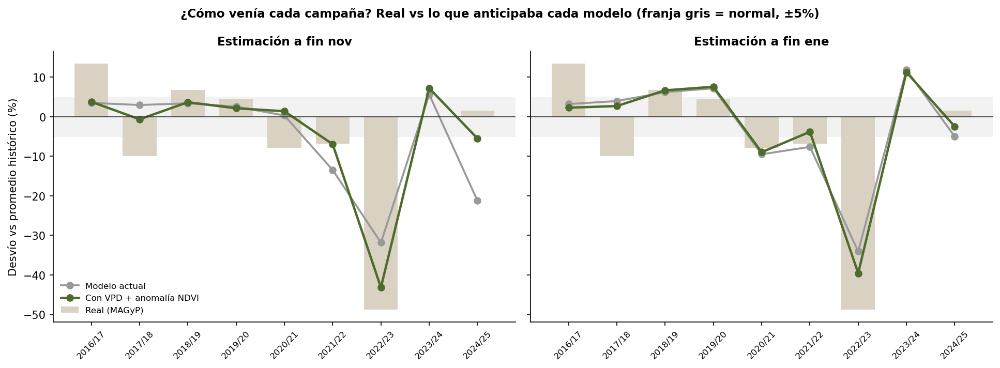
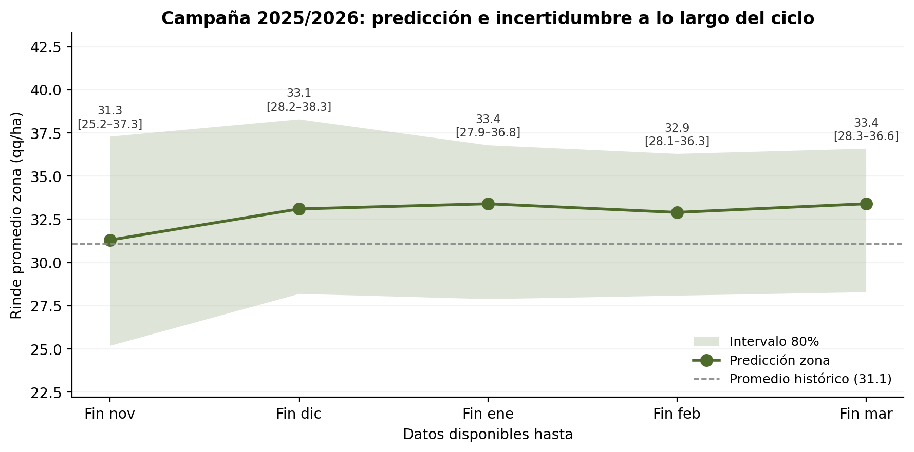

# Estimación temprana del rendimiento de soja

Datos satelitales y climáticos aplicados al noroeste bonaerense.

## Qué es este proyecto

Un sistema que anticipa **cómo viene la campaña de soja** a nivel de partido, desde fines de noviembre y hasta fines de marzo, usando solo datos públicos y gratuitos.

El objetivo no es acertar el rinde exacto. Es detectar con tiempo si la campaña viene por encima o por debajo de lo normal, y aproximadamente cuánto.

Cubre cinco partidos del noroeste de Buenos Aires: General Arenales, Junín, Leandro N. Alem, Lincoln y General Pinto. Son la zona de influencia de una cooperativa agrícola. Usa las campañas 2000/01 a 2024/25, lo que da 125 observaciones.

## Para qué sirve

En el noroeste bonaerense, las cooperativas y plantas de acopio planifican con meses de anticipación la logística, la capacidad de almacenamiento y secado, y la comercialización. Hoy esa planificación suele basarse en promedios históricos o en la percepción de cómo viene el año.

Este modelo no reemplaza la estimación de cosecha. Da una **señal temprana y cuantificada**, con un rango de incertidumbre. Con esa señal, una cooperativa puede:

- ajustar su plan de acopio,
- dimensionar fletes y secado,
- anticipar decisiones de venta.

La variable objetivo es el rinde de soja total por partido (MAGyP), que mezcla soja de primera y de segunda. Es el volumen que efectivamente llega al acopio.

## Resultados principales

Validación walk-forward 2016/17–2024/25: 9 campañas × 5 partidos = 45 estimaciones. En cada una, el modelo nunca vio la campaña que estima.

Cada estimación se compara contra el rinde final de la campaña. Por eso, el error de las ventanas tempranas incluye los eventos que ocurren después del corte, que ningún modelo puede anticipar (por ejemplo, la sequía de febrero–marzo de 2017/18). Esa incertidumbre está reflejada en los intervalos de predicción, que se calculan con los errores reales de cada ventana.

| Datos hasta | Meses antes de cosecha | MAE (qq/ha) | R² | Variables |
|---|---|---|---|---|
| **Fin de noviembre** | ~5 | **2,42** | **0,72** | 16 |
| Fin de diciembre | ~4 | 2,64 | 0,70 | 32 |
| Fin de enero | ~3 | 3,01 | 0,61 | 48 |
| Fin de febrero | ~2 | 2,94 | 0,62 | 64 |
| Fin de marzo | ~1 | 3,02 | 0,59 | 80 |
| *Baseline: promedio histórico por partido* | — | *4,04* | — | — |

- **A fin de noviembre** el error es un 40% menor que usar el promedio histórico.
- **Dirección:** a fin de enero acierta si el partido viene por arriba o por abajo del promedio en 31 de 45 casos (69%; test binomial contra azar, p = 0,008).
- **Años extremos.** En la sequía 2022/23 (rinde un 49% por debajo de lo normal):
  - a fin de noviembre el modelo ya anticipaba una caída del 43%;
  - a fin de enero su error fue de 3,8 qq/ha por partido, contra 15,5 qq/ha del promedio histórico.

> **Sobre la ventana de noviembre.** Que fin de noviembre tenga menos error que los cortes posteriores no se explica por exceso de variables: usar solo las variables de cada corte empeoró el resultado (ver "Estructura de variables y algoritmo"). Lo más probable es que combine una señal temprana fuerte (la anomalía de NDVI) con la variabilidad propia de tener solo 9 campañas de test.

### ¿Acierta cómo viene cada campaña?



*Barras: desvío real de la campaña respecto del promedio histórico (MAGyP). Líneas: lo que anticipaba cada modelo. Franja gris: rango normal (±5%).*

- **Campañas claramente anormales.** Hubo 6 campañas que se apartaron más de ±5% de lo normal. A fin de enero el modelo acertó el sentido del desvío en 5 de ellas.
  - La excepción fue 2017/18: su sequía golpeó en febrero y marzo, después del corte de enero.
  - A fin de febrero el modelo ya la detecta.
- **El modelo tiende a achicar el tamaño de los desvíos.** Por ejemplo, 2016/17 terminó +13% y anticipaba +2% a +4%. Es una limitación conocida del Random Forest: no estima fuera del rango que vio en el pasado.

## Versión 2: VPD y anomalía de NDVI

La versión actual agrega dos variables construidas con datos que el proyecto ya descargaba.

| Variable | Qué mide | Qué no capturaba antes |
|---|---|---|
| **VPD** (déficit de presión de vapor, FAO-56) | Cuánta agua le "exige" el aire a la planta. Con VPD alto la soja cierra estomas y deja de crecer. | El modelo tenía temperatura y humedad por separado, pero su efecto combinado no es lineal: 40% de humedad a 20 °C no se parece a 40% a 33 °C. Con 125 observaciones el modelo no llega a aprender esa combinación por sí solo. |
| **Anomalía de NDVI** | NDVI menos lo normal de ese partido en esa fecha del año (normal = promedio 2000–2015). | El NDVI crudo mezcla "cómo es el partido siempre" (lagunas, pasturas) con "cómo viene este año". La anomalía deja solo lo segundo. En noviembre, cuando la soja recién emerge, muestra si el campo arranca más seco o más verde que lo normal. |

**Impacto.** Comparación contra la versión 1, con la misma validación y el promedio de 5 semillas del Random Forest. El intervalo es al 80%, por bootstrap de campañas.

| Datos hasta | Cambio en MAE | IC 80% | Campañas que mejoran |
|---|---|---|---|
| Fin de noviembre | **−1,02 qq/ha** | [−1,78; −0,32] | 6/9 |
| Fin de diciembre | **−0,73 qq/ha** | [−1,34; −0,10] | 6/9 |
| Fin de enero | −0,16 qq/ha | [−0,39; +0,07] | 5/9 |
| Fin de febrero | −0,22 qq/ha | [−0,52; +0,05] | 5/9 |
| Fin de marzo | −0,10 qq/ha | [−0,36; +0,13] | 3/9 |

**Dónde mejora.** La mejora es clara en noviembre y diciembre, que es justamente cuando más vale anticipar. Desde enero el modelo ya tiene suficiente información de la campaña y la diferencia se vuelve marginal.

**Control.** Para descartar que la anomalía de NDVI solo le estuviera "diciendo al modelo qué partido es", se probó darle directamente el nombre del partido. La mejora fue casi nula (−0,04 qq/ha en noviembre).

**Ejemplo, campaña 2024/25.** A fin de noviembre la versión 1 anticipaba una caída del 21%, y la campaña terminó normal (+1,5%). La versión 2 anticipaba −5,5%: también se equivocó, pero evitó una falsa alarma grande.

**Advertencia.** Buena parte de la mejora se concentra en dos campañas atípicas, 2022/23 y 2024/25. Además, se probaron varias variantes sobre las mismas 9 campañas de test, lo que hace el resultado algo optimista. La confirmación definitiva será la campaña 2025/26, cuando MAGyP publique los datos por departamento.

### Variables evaluadas y descartadas

En el notebook 11 se probaron, con el mismo criterio, otras variables con sentido agronómico:

| Variable | Resultado |
|---|---|
| Balance hídrico (lluvia − evapotranspiración, Hargreaves) | Mejora mínima, sin impacto práctico |
| Distribución de lluvias (racha seca máxima, variabilidad diaria) | Empeora |
| Lluvia pre-siembra (julio–septiembre) | Sin efecto |
| Condiciones del último mes de cada ventana | Sin efecto consistente |
| Tendencia tecnológica (quitar la tendencia lineal del rinde) | Empeora mucho: proyectaba subas que no ocurrieron |
| Grados-día (GDD) | No se probó: con ventanas de calendario fijas equivale a la temperatura media, que el modelo ya tiene |

### Estructura de variables y algoritmo

Como última prueba (notebook 11, parte 5), se compararon cuatro combinaciones, todas con las variables de la versión 2. Se fijó una regla antes de ver los resultados: cambiar el modelo solo si una opción mejoraba de forma concluyente en al menos 2 cortes y no empeoraba en ninguno.

| Opción | Resultado |
|---|---|
| **Random Forest, variables acumuladas (actual)** | Referencia |
| Random Forest, solo las variables de cada corte | Empeora en diciembre y enero: las variables de cortes anteriores aportan la trayectoria de la campaña |
| **Gradient Boosting, variables acumuladas** | Menor error en los 5 cortes (−0,07 a −0,60 qq/ha), concluyente solo en febrero |
| Gradient Boosting, solo las variables de cada corte | Empeora |

**Decisión.** Se mantiene el Random Forest. Gradient Boosting queda documentado como alternativa candidata, y la campaña 2025/26, que ninguno de los dos vio, servirá para desempatar cuando MAGyP publique los datos.

### El Niño / La Niña

El índice ONI de NOAA (agosto–octubre) no mejora el modelo. Las variables climáticas y el NDVI ya reflejan el efecto de ENSO a medida que ocurre, y hay pocas campañas de cada fase.

Igual es contexto útil para leer una campaña:

| Fase de ENSO en la siembra (2000–2024) | Rinde medio de la zona | Campañas |
|---|---|---|
| La Niña | 28,8 qq/ha | 6 |
| Neutral | 30,7 qq/ha | 12 |
| El Niño | 33,9 qq/ha | 7 |

## Intervalos de predicción

Cada estimación se acompaña de un **intervalo de predicción del 80%**. Se calcula por el método conformal, a partir de los errores reales del modelo en el walk-forward:

- **Es asimétrico.** El error hacia abajo es mayor que hacia arriba, porque las sequías castigan más de lo que un buen año suma.
- **Por qué 80% y no 95%.** Con 45 errores históricos, un 95% dependería de uno o dos casos extremos y sería demasiado ancho para servir.
- **Intervalo de la zona.** Se calcula con el error promedio de cada campaña y no partido por partido, porque los partidos comparten clima y se equivocan juntos.

## Predicción campaña 2025/26

Promedio de la zona. Promedio histórico 2000–2024: 31,1 qq/ha.

| Datos hasta | Estimación | Intervalo 80% | vs. promedio histórico |
|---|---|---|---|
| Fin de noviembre | 31,8 qq/ha | 28,7 – 34,9 | +2,2% |
| Fin de diciembre | 33,4 qq/ha | 28,8 – 36,0 | +7,3% |
| Fin de enero | 33,9 qq/ha | 29,8 – 37,6 | +8,9% |
| Fin de febrero | 33,5 qq/ha | 29,9 – 37,4 | +7,7% |
| Fin de marzo | 34,0 qq/ha | 30,1 – 37,8 | +9,3% |



**Lectura.** La señal de campaña buena aparece desde diciembre y se mantiene estable: entre +7% y +9% sobre lo normal. Es coherente con los informes de cierre de campaña que marcan buenos rindes en la región.

**Pendiente.** La verificación cuantitativa queda para cuando MAGyP publique los rindes 2025/26 por departamento. Las referencias regionales no son directamente comparables: suelen informar solo soja de primera o abarcar regiones más amplias.

## Fuentes de datos

| Fuente | Qué aporta | Resolución |
|---|---|---|
| [MAGyP](https://datos.magyp.gob.ar/) — Estimaciones Agrícolas | Rendimiento histórico por departamento (variable objetivo) | Anual por partido |
| [NASA POWER](https://power.larc.nasa.gov/) | Temperatura, humedad, punto de rocío, precipitación, radiación | Diaria, grilla ~55 km |
| [MODIS MOD13Q1](https://lpdaac.usgs.gov/products/mod13q1v061/) vía Google Earth Engine | NDVI (índice de vegetación) | Cada 16 días, 250 m |
| [NOAA CPC — ONI](https://www.cpc.ncep.noaa.gov/data/indices/oni.ascii.txt) | Índice de El Niño / La Niña (solo como contexto, notebook 11) | Trimestral |

## Metodología

**Ventanas temporales.** Las variables se acumulan desde octubre hasta cinco cortes: fin de noviembre, diciembre, enero, febrero y marzo. Cada corte simula el momento en que se emitiría la estimación.

**Variables por ventana (16):**

- **Clima (9):** lluvia acumulada, temperatura media, máxima y mínima, radiación, humedad, días con más de 35 °C, días sin lluvia, VPD.
- **NDVI (7):** media, máximo, mínimo, desvío, pendiente, anomalía media y anomalía a la fecha de corte.

**Modelo.** Random Forest (100 árboles, profundidad máxima 5), un modelo por ventana.

- Se compararon también Regresión Lineal y Gradient Boosting. Gradient Boosting obtuvo menos error en todos los cortes, pero la mejora fue concluyente en uno solo, así que no cumplió la regla de cambio (ver "Estructura de variables y algoritmo").
- En el notebook 07 se probaron Ridge, Lasso, ElasticNet, XGBoost, SVR y KNN, sin mejora sobre el Random Forest.

**Validación.** Walk-forward temporal estricto:

1. Entrena con 2000/01–2015/16 y estima 2016/17.
2. Suma esa campaña al entrenamiento y estima la siguiente, hasta 2024/25.

Ningún dato futuro se usa para entrenar. El NDVI "normal" de la anomalía se calcula solo con 2000–2015, que siempre quedan del lado del entrenamiento.

## Cómo ejecutarlo

```bash
pip install -r requirements.txt
```

Se necesita una cuenta de Google Earth Engine habilitada para descargar el NDVI. NASA POWER no requiere autenticación.

**Pipeline completo (notebooks, en orden):**

1. `01_descarga_datos` y `02_descarga_ndvi`: descargan clima y NDVI.
2. `03_feature_engineering`: arma el dataset de modelado y guarda el NDVI normal 2000–2015.
3. `04_modelado`: entrena y valida los modelos, y calcula los intervalos.
4. `05_prediccion`: estima la campaña en curso.

**Predicción rápida desde la terminal** (después de correr hasta el 03):

```bash
python src/predict.py                    # campaña en curso (detecta la fecha)
python src/predict.py --campana 2025     # campaña específica
python src/predict.py --ventana oct_nov  # forzar una ventana
```

Las rutas se definen en `src/config.py`, así que los notebooks corren desde cualquier máquina sin tocar paths.

## Estructura del repositorio

```
prediccion-rinde-soja/
├── docs/                     # Documentación del proyecto
├── notebooks/
│   ├── 01_descarga_datos
│   ├── 02_descarga_ndvi
│   ├── 03_feature_engineering      # incluye VPD y anomalía de NDVI (v2)
│   ├── 04_modelado                 # validación walk-forward e intervalos
│   ├── 05_prediccion               # campaña en curso
│   ├── 06_figuras_documentacion
│   ├── 07_experimentos_ml          # otros algoritmos
│   ├── 08_exploracion_mascara_cultivos
│   ├── 09_ndvi_filtrado_soja
│   ├── 10_test_ndvi_filtrado
│   └── 11_experimento_features_nuevas  # prueba de variables v1 vs v2
├── outputs/                  # Figuras y resultados
├── src/
│   ├── config.py             # Partidos, parámetros y rutas
│   ├── descargar_nasa_power.py
│   └── predict.py            # Predicción desde la terminal
├── requirements.txt
└── README.md
```

Los datos crudos (MAGyP, NASA POWER, NDVI) no se incluyen en el repositorio. Los notebooks 01 y 02 los descargan.

## Alternativas exploradas

**NDVI filtrado a soja.** Se probó restringir el NDVI a los píxeles clasificados como soja, con el Mapa Nacional de Cultivos del INTA (campañas 2019/20 a 2023/24).

- Las curvas filtradas resultaron más coherentes.
- Pero al alimentarlas al modelo entrenado con NDVI sin filtrar, el error aumentó (MAE 3,08 → 3,80, medido con la versión 1).
- Para aprovecharlo habría que reentrenar con la señal filtrada, y para eso hace falta una serie más larga.

## Limitaciones

- **Escala.** Opera a nivel de partido; no sirve para estimar lotes individuales.
- **NDVI mezclado.** El NDVI promedia todos los usos del suelo del partido (pasturas, montes, zonas urbanas). La anomalía reduce el problema, pero no lo elimina.
- **Extremos.** El Random Forest no estima fuera del rango histórico, así que tiende a achicar los desvíos en campañas extremas.
- **Soja de primera y de segunda.** El rinde de MAGyP las mezcla. Un año con más soja de segunda baja el promedio aunque el clima haya sido bueno.
- **Variables que faltan.** No incorpora manejo (cultivar, fecha de siembra, fertilización), suelo, plagas ni granizo.
- **Eventos posteriores al corte.** Lo que pasa después de la fecha de corte no se ve, como ocurrió con la sequía tardía de 2017/18.
- **Pocas campañas de test.** Con 9 campañas, las diferencias chicas entre variantes no son concluyentes.

## Próximos pasos

- **Validar con la campaña 2025/26** cuando MAGyP publique los rindes por departamento, comparando Random Forest y Gradient Boosting.
- **Ampliar los datos.** Con más partidos de la zona núcleo o más campañas, se podrían revisar Gradient Boosting y el NDVI filtrado a soja con más respaldo estadístico.

## Autor

Agustín Musanti — [agustinmusanti@gmail.com](mailto:agustinmusanti@gmail.com)
